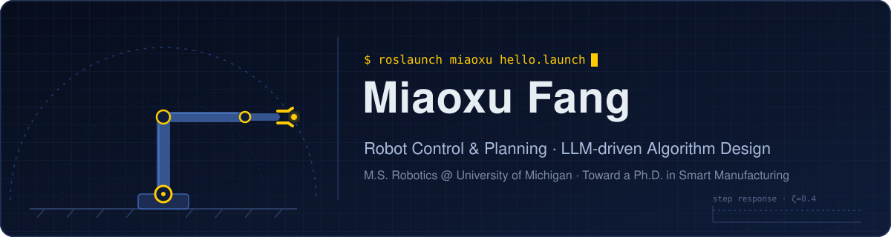

<p align="center">
  
</p>

<p align="center">
  
</p>

<p align="center">
  <a href="https://scholar.google.com/citations?user=zI2jTTkAAAAJ&hl=en"></a>
  <a href="mailto:mxfang@umich.edu"></a>
</p>

---

### 🤖 About me

```python
class MiaoxuFang(Researcher):
    affiliation = "M.S. Robotics @ University of Michigan (2026 – 2028)"
    interests   = ["robot control", "motion planning", "mobile manipulation",
                   "LLM-driven automated algorithm design", "smart manufacturing"]
    next_step   = "Ph.D. in smart manufacturing — open to conversations"
    fun_fact    = "My controllers are increasingly written by my LLM pipelines."
```

### 🔬 Research threads

<table>
  <tr>
    <td width="50%" valign="top">
      <h4>🧬 LLM-driven program evolution</h4>
      Using LLMs to <b>evolve controller programs</b> automatically — from search space to verified closed-loop behavior.
      <br/><sub><b>RuleForge</b> · under review</sub>
    </td>
    <td width="50%" valign="top">
      <h4>🦾 Mobile manipulator planning</h4>
      Coordinated base–arm planning for manipulation in cluttered, real-world scenes.
      <br/><sub>Published</sub>
    </td>
  </tr>
  <tr>
    <td width="50%" valign="top">
      <h4>🎛️ Robot control</h4>
      Controller design with an eye on robustness and deployability on real hardware.
      <br/><sub>Published</sub>
    </td>
    <td width="50%" valign="top">
      <h4>🏭 Remanufacturing optimization</h4>
      Intelligent optimization for disassembly and remanufacturing systems.
      <br/><sub>Published</sub>
    </td>
  </tr>
</table>

<!-- 有了公开仓库后，取消下面的注释并填上链接，就会出现项目表
### 📌 Featured projects

| Project | What it does | Links |
|:--|:--|:--|
| **[RuleForge](https://github.com/miaoxuf/RuleForge)** | LLM-driven program evolution for automated controller design | [Code](https://github.com/miaoxuf/RuleForge) |
-->

### 🛠️ Toolbox

<p align="left">
  
</p>

<p align="center"><sub>Always happy to talk robots, controllers, and factories that run themselves.</sub></p>
